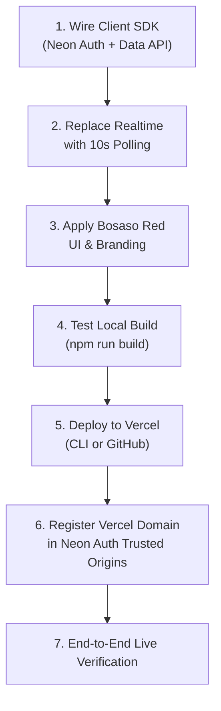

# Neon Migration Completion & Vercel Deployment Plan

A comprehensive roadmap to complete the Neon migration for the **QR Attendance System (Bosaso Branch)** and deploy the production application to **Vercel**.

---

## 1. Executive Summary & Current Status

### ✅ Completed Milestones
1. **Neon CLI & Authentication**: Installed `neon 9.3.2`, authenticated as `dhomdesign1@gmail.com`.
2. **Project Linkage**: Linked local directory to Neon Project `qr-attendance-system-Bossaso` (`winter-surf-70097462`), branch `production`, org `org-hidden-night-29072318`.
3. **Backend Services Provisioned**:
   - Autoscaling Lakebase Postgres 18.
   - Neon Auth (Managed Better Auth) at `https://ep-tiny-darkness-zac88kv4.neonauth.c-2.eu-west-2.aws.neon.tech/neondb/auth`.
   - Neon Data API (PostgREST-compatible) at `https://ep-tiny-darkness-zac88kv4.apirest.c-2.eu-west-2.aws.neon.tech/neondb/rest/v1`.
4. **Environment Variables**: Extracted and populated in `.env.local`.
5. **Database Schema Deployed**:
   - `public.profiles` (linked to `neon_auth.user(id)`).
   - `public.attendance` (shift tracking, Mogadishu timezone validation).
   - `public.qr_tokens` (SHA-256 token hashes, auto-expiry).
   - `public.app_settings` (morning/afternoon late thresholds).
   - Stored functions: `create_qr_token`, `revoke_qr_tokens`, `scan_attendance`, `admin_create_user`, `admin_update_employee`, `admin_delete_employee`, `admin_reset_password`, `is_admin()`.
   - PostgREST roles & RLS: configured for `authenticated` and `anonymous`.
   - Migrations: `db/migrations/000_base_schema.sql` … `003_qr_ttl_and_revoke.sql`.
6. **Admin Account Initialized** (via `node scripts/bootstrap-admin.mjs`):
   - Email: `admin@attendance-login.example.com`
   - Username: `admin`
   - Password: stored in the git-ignored `.env.local` (`ADMIN_PASSWORD`)
   - Role: `admin`

---

## 2. Deployment Status

Steps 1–4 and 7 below are **done** (client wired to Neon Auth + Data API, realtime replaced by 10 s polling, Bosaso branding applied, `npm run build` passes, and `node scripts/e2e-neon.mjs` reports 17/17). What remains is the Vercel deploy and trusted-origin registration (steps 5–6).



---

## 3. Implementation Details for Remaining Tasks

### Phase A: Wire Frontend to Neon Backend

#### 1. Client Library Setup (`src/lib/neon.ts`)
Replace legacy `@supabase/supabase-js` references with a unified Neon client combining:
- `@neon/auth` for authentication (`signIn.email`, `signUp.email`, `getSession`, `signOut`, `token`).
- Neon Data API (via `@neon/neon-js/supabase` or direct PostgREST client) for database operations and RPC invocations.

```typescript
import { createAuthClient } from '@neon/auth';

export const authClient = createAuthClient(
  import.meta.env.VITE_NEON_AUTH_URL || 'https://ep-tiny-darkness-zac88kv4.neonauth.c-2.eu-west-2.aws.neon.tech/neondb/auth'
);

export const DATA_API_URL = 
  import.meta.env.VITE_NEON_DATA_API_URL || 'https://ep-tiny-darkness-zac88kv4.apirest.c-2.eu-west-2.aws.neon.tech/neondb/rest/v1';
```

#### 2. Authentication Flow (`src/pages/Login.tsx` & `src/App.tsx`)
- On Login submit: Call `authClient.signIn.email({ email, password })`.
- Retrieve JWT token and user metadata.
- Fetch matching profile from `public.profiles` where `id = user.id`.
- Support username auto-resolution: If user enters `admin`, resolve to `admin@attendance-login.example.com`.

#### 3. Database & RPC Calls (`src/lib/api.ts`)
- `generateQrToken`: Calls `POST /rpc/create_qr_token` with Bearer JWT token.
- `recordAttendance`: Calls `POST /rpc/scan_attendance` with scanned token.
- `createEmployeeAccount`: Registers user via Neon Auth and inserts profile.
- `adminUpdateEmployee`, `adminResetPassword`, `adminDeleteEmployee`: Call corresponding Neon stored procedures.

#### 4. Dashboard Auto-Refresh (`src/pages/Admin.tsx`)
- Replace obsolete `supabase.channel('attendance-live')` with 10-second polling interval:
  ```typescript
  useEffect(() => {
    load();
    const interval = setInterval(load, 10000);
    return () => clearInterval(interval);
  }, []);
  ```

---

### Phase B: UI Polish & Bosaso Red Theme

1. **Branding Updates**:
   - Header & Topbar: Display **Bosaso Attendance Portal** with a dedicated `📍 Bosaso Branch` pill.
   - Login page: Headline **Bosaso Branch · Employee Management**.
   - QR Poster & Print View: **Bosaso Office Attendance Check-In**.
   - Page Titles: Update `index.html` to `Bosaso Attendance Portal`.
2. **Red Design Palette**:
   - Primary Crimson: `#dc2626` / `#b91c1c`
   - Dark Obsidian-Burgundy Topbar: `#160709` with crimson bottom border
   - Accents: Red pulses for active QR rotation, red buttons with soft ruby glows, clean card micro-borders.

---

### Phase C: Vercel Deployment

#### 1. Vercel Configuration Check
The existing [`vercel.json`](file:///C:/Users/HCF/Downloads/QR_Attendance_System_Starter/qr-attendance-system-Bossaso/vercel.json) correctly handles client-side routing:
```json
{
  "rewrites": [
    {
      "source": "/(.*)",
      "destination": "/index.html"
    }
  ]
}
```

#### 2. Required Vercel Environment Variables
Add these in the **Vercel Dashboard &rarr; Project Settings &rarr; Environment Variables**:

| Variable Name | Environment | Value | Description |
|---------------|-------------|-------|-------------|
| `VITE_NEON_AUTH_URL` | Production, Preview | `https://ep-tiny-darkness-zac88kv4.neonauth.c-2.eu-west-2.aws.neon.tech/neondb/auth` | Neon Managed Better Auth base URL |
| `VITE_NEON_DATA_API_URL` | Production, Preview | `https://ep-tiny-darkness-zac88kv4.apirest.c-2.eu-west-2.aws.neon.tech/neondb/rest/v1` | Neon Data API PostgREST endpoint |

#### 3. Trusted Origins Registration
Neon Auth requires every domain that initiates authentication requests to be registered in its allowlist.
Once your Vercel project is created (e.g. `qr-attendance-bossaso.vercel.app`):
```bash
# Register production domain
neon neon-auth domain add https://qr-attendance-bossaso.vercel.app

# Verify registered domains
neon neon-auth domain list
```

#### 4. Deployment Methods

**Option 1: Deploy via Vercel Git Integration (Recommended)**
1. Ensure all changes are committed and pushed to GitHub:
   ```bash
   git add .
   git commit -m "feat: complete Neon backend migration and Bosaso UI"
   git push origin main
   ```
2. In Vercel (`https://vercel.com/new`), import repository `imabdram/qr-attendance-system-Bossaso`.
3. Set Framework Preset: `Vite`.
4. Add the two environment variables listed above.
5. Click **Deploy**.

**Option 2: Deploy via Vercel CLI**
```bash
npx vercel
# Follow prompts to link project
# For production deployment:
npx vercel --prod
```

---

## 4. Verification & Testing Checklist

- [ ] **Build Validation**: `npm run build` passes with zero errors.
- [ ] **Admin Authentication**: Sign in using `admin` / `AdminPassword123!`.
- [ ] **Live Dashboard**: Confirm today's arrivals load and auto-refresh every 10 seconds.
- [ ] **Office QR Generation**: Generate 25s auto-rotating, manual, and fixed QR codes.
- [ ] **Employee Creation**: Create a test employee account (Morning/Afternoon shift).
- [ ] **Employee Attendance Scan**: Verify check-in registers on-time or late according to Mogadishu time.
- [ ] **Vercel Production Test**: Access live Vercel URL, sign in, and perform end-to-end check-in.
